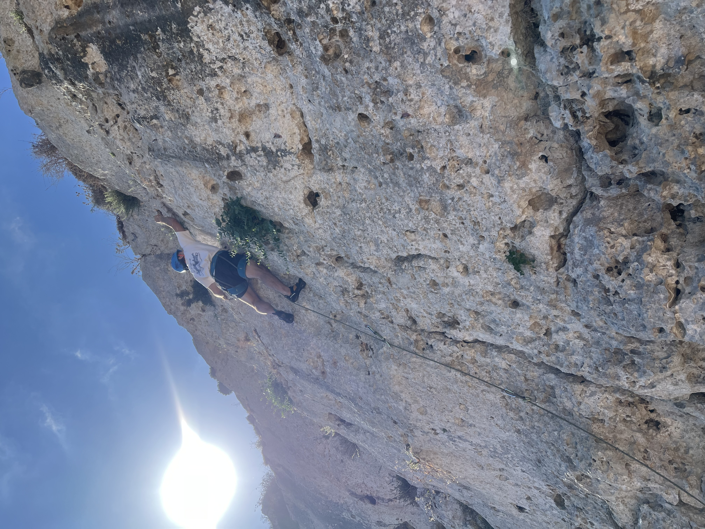

{: .align-right width="300px"}
Hello everyone! I am a PhD candidate at [Imperial College London](https://www.imperial.ac.uk) in the [Earth Science and Engineering department](https://www.imperial.ac.uk/earth-science/) being supervised by [Dr. Ben Moseley](https://benmoseley.blog) and am a researcher at [Imperial's Scalable Scientific Machine Learning Lab](https://scalable-sciml-lab.org). I am a Machine Learning (ML) researcher focusing on bridging the gap between numerical methods and scientific ML for solving PDEs. I have a particular interest in how the world around us can be modelled accurately and efficiently. Currently I am working on improving ML-based methods to solve large, multi-scale tasks by combining them with numerical methods.   

# About Me

I read for a B.Eng in Mechanical Engineering at the [University of Malta](https://www.um.edu.mt), here I became interested with fluid dynamics, but specifically I found myself looking for ways to overcome the computational difficulties and complexities of CFD. Under the supervision of [Prof. Christopher Micallef](https://www.um.edu.mt/profile/christophermicallef), I graduated with a thesis focusing on developing a vortex-lattice method solver in Python, which was awarded the Dean's award for best final year project and shortlisted me for a number of engineering body prizes. 

I recently completed an MSc. in Advanced Computational Methods for Aeronautics at [Imperial College London](https://www.imperial.ac.uk) in the [Department of Aeronautics](https://www.imperial.ac.uk/aeronautics/), where I was instructed in research-informed methods to computationally represent flow phenomena. Here I completed a thesis under the supervision of [Dr. Lloyd Fung](https://llfung.github.io), where we focused on developing the mathematical equivalence between the Finite Element Method (FEM) and Single-Layer Perceptron (SLP) neural networks. This work highlighted the similarities of numeric methods and scientific ML and has inspired where I am now and my current research interests. We have published our ideas in a [blog on Lloyd's website](https://llfung.github.io/blog/) - feel free to read :) and reach out with any feedback!
